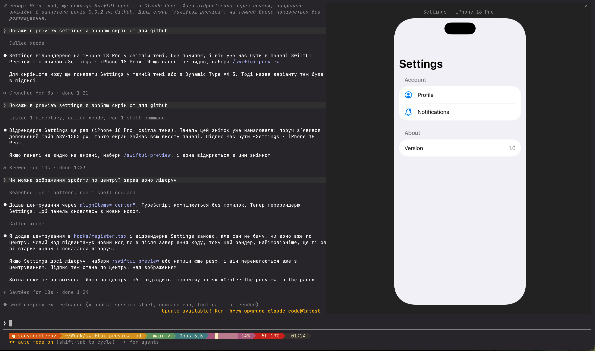

# swiftui-preview

A Claude Code mod that shows SwiftUI previews right in the terminal, rendered by Xcode itself.



Claude calls Xcode's `RenderPreview` MCP tool on a `#Preview`; the mod shows the snapshot in a
**SwiftUI Preview** pane — components 1:1 in points like Xcode's canvas at 100%, whole screens
fit to the pane. Variants (dark mode, Dynamic Type, orientation), localizations and
`#Preview(arguments:)` come from `RenderPreview` itself.

## Requirements

- macOS with Xcode 27, MCP on: Settings › Intelligence › Model Context Protocol ›
  "Allow External Agents to Use Xcode Tools" = Always (or `sudo xcrun mcp-server enable`)
- The project open in Xcode
- A terminal that draws images (Ghostty, kitty)

## Install

```
claude mcp add xcode -s user -- xcrun mcpbridge
```

then, at a Claude Code prompt:

```
/plugin install swiftui-preview --marketplace degterev/swiftui-preview-mod
```

Answer `y` to add the marketplace, then pick a scope.

## Use

Ask Claude in plain words; if the file has no `#Preview`, Claude adds one.

- "show SettingsView"
- "preview the badge in dark mode at AX 3"
- "show ProfileView in Ukrainian, landscape"

The pane opens with each render, labelled with the preview, device and variant
(`Settings · iPhone 18 Pro · Dark Appearance`). When the terminal is too narrow to place it,
a toast says so; `/swiftui-preview` reopens the pane with the last render.

### Zoom

`[ − ] [ 100% ] [ + ]` beside the label zoom from 50% to 400%; click the percentage to reset.
With the pane focused (click it), `i` zooms in, `o` out, `0` resets. Zoomed in, the picture can
outgrow the pane's height, which scrolls, but never its width. The terminal passes no pinch to
apps, so a trackpad scrolls the pane but does not zoom it.

## How it sizes the picture

- The terminal's cell size is measured, so a component takes its real size in points.
- Components are never enlarged; whole-device screens fit the pane's height.
- The snapshot is padded to the pane's cell grid, so it is never stretched.

## Limitations

- Assumes a Retina (2x) display: on a 1x monitor components show twice their size.
- Xcode caps a snapshot's long side at 1500 px, so a whole screen in a very tall pane is slightly soft.
- Only the last render is kept.
- No horizontal panning: a whole screen zoomed past the pane's width stays at that width.

## Development

```
claude plugin validate .
claude plugin test .
```

## License

MIT
